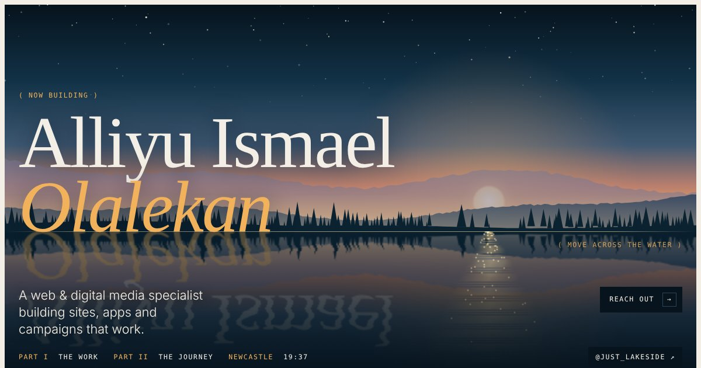

# justlakeside.com

The portfolio and CV site of **Alliyu Ismael Olalekan** (JustLakeside), a web and digital media specialist in Newcastle upon Tyne.

**Live:** [justlakeside.com](https://justlakeside.com)



## What's inside

- **Interactive lake hero.** A canvas-painted dusk sky, sun, mountain ridges and treeline, mirrored into a lake. A small ripple simulation bends the reflection wherever the cursor moves or a finger taps, and glints dance along the sun's path.
- **Project wall.** Selected work shown as tilted prints with live-site screenshots.
- **Experience, skills and education** taken from the CV.
- **WhatsApp chat.** A floating button opens a chat panel with quick replies that start a WhatsApp conversation with a ready-made message.

## How it's built

It's a single static `index.html` with no build step and no dependencies apart from Google Fonts (Bodoni Moda, Manrope, DM Mono). Images are embedded, so the page works on any static host.

| File | Purpose |
| --- | --- |
| `index.html` | The whole site: markup, styles and scripts |
| `share.jpg` | Preview image for links shared on social media |
| `favicon.ico`, `favicon-32.png`, `apple-touch-icon.png` | Browser and home-screen icons |

The hero respects `prefers-reduced-motion`: the water stays still until someone touches it.

## Deploying

The site is hosted on Namecheap shared hosting, behind Cloudflare. To update it, upload the changed files to the `justlakeside.com` folder in cPanel File Manager.

To preview locally, open `index.html` in a browser, or run:

```sh
python3 -m http.server 8000
```

## Contact

- Instagram and Facebook: [@just_lakeside](https://www.instagram.com/just_lakeside)
- LinkedIn: [alliyuismaelolalekan](https://www.linkedin.com/in/alliyuismaelolalekan)

© 2026 Alliyu Ismael Olalekan. All rights reserved.
